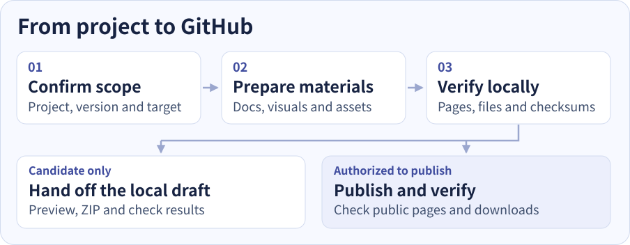
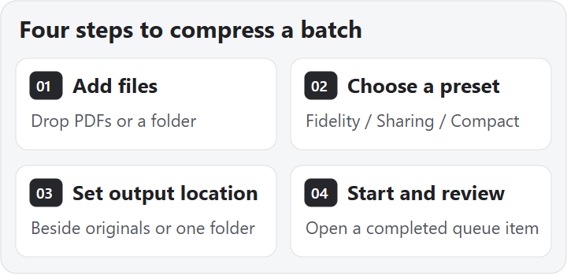

# Release Publisher

[简体中文](README.md) · [Install and invoke](#install-and-invoke) · [Workflow](#workflow) · [Capabilities and deliverables](#capabilities-and-deliverables) · [Case study](#case-study)

Turn an existing **Agent Skill or Windows desktop app** into a GitHub release you can review, publish, and verify. Provide the project and scope. Release Publisher aligns the introduction, visuals, installation links, release package, and version record.

## Install and invoke

1. Extract [release-publisher-v1.0.0.zip](https://github.com/xmonk888-art/release-publisher/releases/download/v1.0.0/release-publisher-v1.0.0.zip) to get the `release-publisher` directory.
2. Copy the entire directory into your project's `.agents/skills/` so the entry point is `.agents/skills/release-publisher/SKILL.md`. For use across projects, place it under `~/.agents/skills/`. Check the installed version and any local customizations if a skill with the same name exists.
3. Open the project in Codex and type `$release-publisher` followed by your task. If the skill is missing from the list, reopen Codex and check again. [Codex skill locations](https://learn.chatgpt.com/docs/build-skills#where-codex-loads-local-skills)

**Copy into a Codex conversation**

```text
$release-publisher Prepare an illustrated GitHub release candidate for this project.
Keep the current version and prepare bilingual READMEs, a workflow diagram, and a local preview.
Check the page and existing installer locally. Hold the upload.
```

## Workflow

<picture>
  <source media="(max-width: 760px)" srcset="assets/workflow-en-mobile.svg">
  
</picture>

| Task | What Release Publisher does |
| --- | --- |
| **Prepare a candidate** | Prepare local docs, a package, and check results with a clear place to review them. |
| **Update the project page** | Submit the approved docs and public media, then verify the page, images, and existing download links. |
| **Publish a new version** | Match the source, version, tag, and assets. Publish as authorized and verify the public result. |

## Capabilities and deliverables

| Capability | Typical deliverables |
| --- | --- |
| **Illustrated project page** | Bilingual READMEs, a workflow diagram, and download links. Use real screenshots for software features and a short GIF when the sequence benefits from one. |
| **Standalone skill ZIP** | A package with the skill entry point, working relative links, and required resources, verified by extraction. |
| **Windows release preparation** | A consistent build, installer, version, and compatibility description. Verify installation, launch, or upgrade where the target environment is available. |
| **GitHub publishing and verification** | Confirm the target and access, handle commits, releases, and assets, and record public-page and download checks with SHA-256. |

Local preparation can start first. GitHub writes require the right account access and authorization for the current task. Installation and runtime claims reflect the environments actually tested.

## Case study

**PDF Compressor v2.4.1** received a documentation update. The public pages were checked at 320, 390, and 1280 CSS pixels. Phone-sized viewports selected the stacked diagram and desktop selected the existing four-card grid. Both layouts loaded the feature screenshots and played the GIF. The installer was downloaded again from the release and matched the previous SHA-256.

<picture>
  <source media="(max-width: 600px)" srcset="assets/case-pdf-en-phone.png">
  
</picture>

The image shows the diagram area of the public GitHub page. Phone layouts were tested with browser viewport emulation. [View the project page](https://github.com/xmonk888-art/pdf-compressor/blob/main/README.en.md#quick-start) · [View the docs commit](https://github.com/xmonk888-art/pdf-compressor/commit/31555f8c6a201c2c9151b37f8c3b19bf92d3fac1)

## Package contents

- [Skill entry point](SKILL.md) with scope, sequence, and authorization boundaries.
- [Software visuals](references/software-visual-guide.md) and [skill packaging](references/skill-package.md) guides.
- [GitHub publishing guide](references/github-release.md) and [asset verification script](scripts/check_release_artifact.py).
