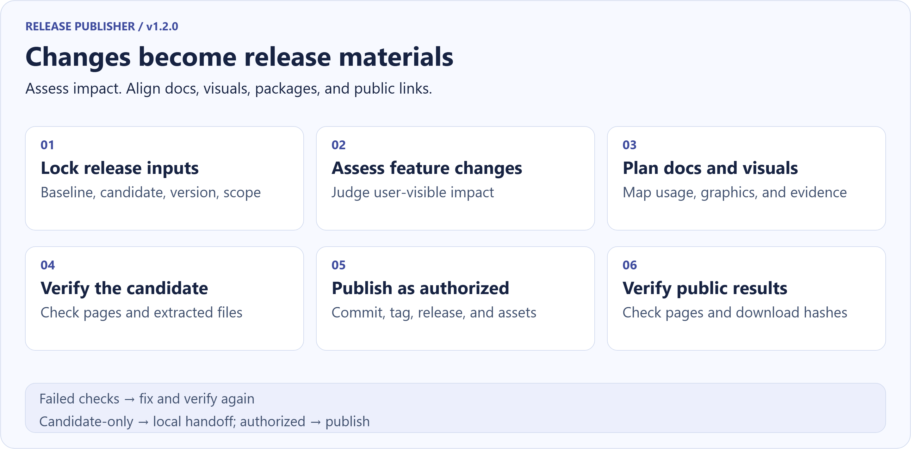
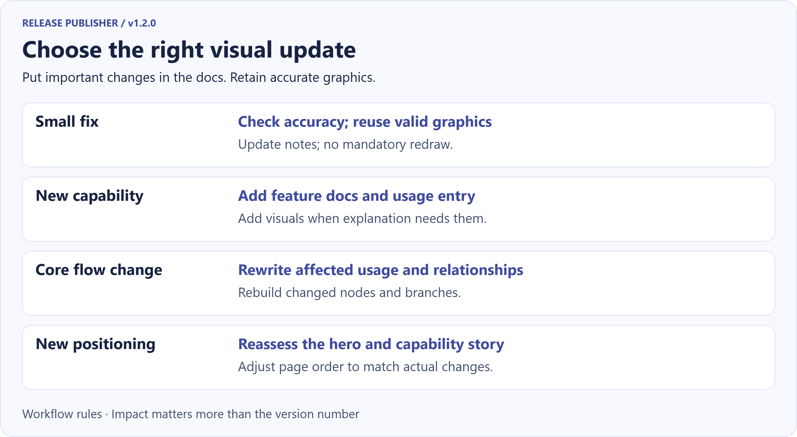
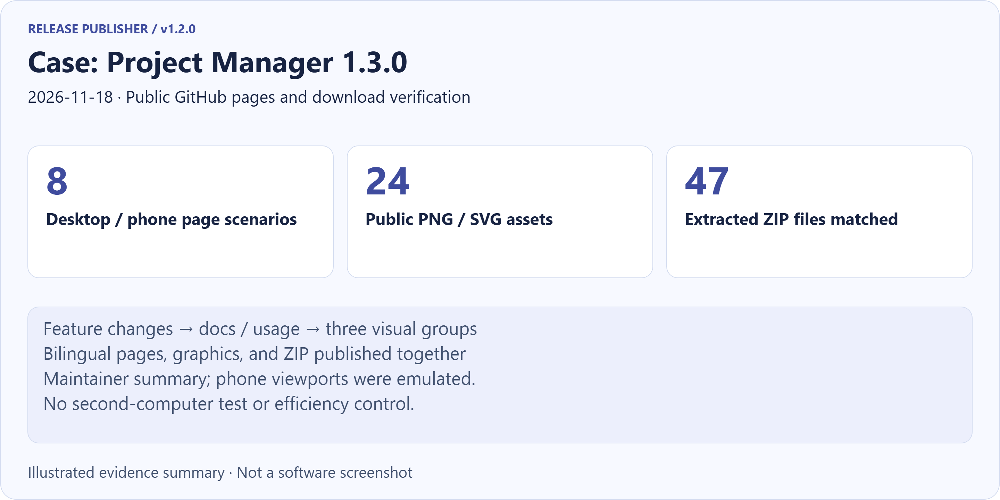
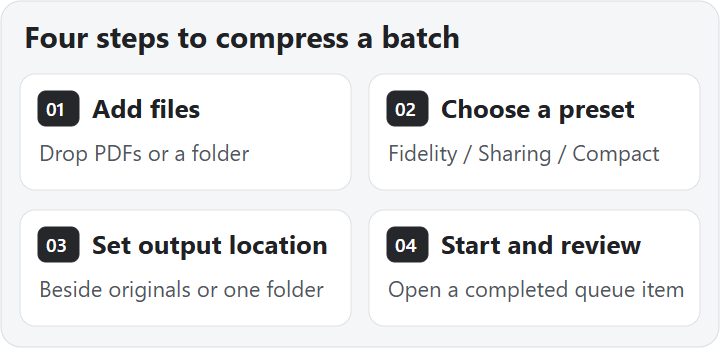

# Release Publisher

[简体中文](README.md) · [Install and invoke](#install-and-invoke) · [Updated workflow](#updated-workflow) · [Case studies](#case-studies)

Turn an existing **Agent Skill or Windows desktop app** into a GitHub release readers can understand, install, and verify. When capabilities change, keep the explanation, usage, visuals, and package aligned.

<p align="center"><a href="assets/v1.2.0/release-flow-en.svg"><picture><source media="(max-width: 600px)" srcset="assets/v1.2.0/release-flow-en-mobile.png"></picture></a></p>

<a id="latest-release"></a>

> **Latest version · v1.2.0**
>
> Assess user-visible changes before deciding which docs and visuals need updates. Reuse accurate graphics and rebuild affected core flows. Verify bilingual pages, installation links, ZIPs, and releases together.
>
> [Download the update](https://github.com/xmonk888-art/release-publisher/releases/download/v1.2.0/release-publisher-v1.2.0.zip) · [Full release notes](https://github.com/xmonk888-art/release-publisher/releases/tag/v1.2.0)

## Install and invoke

**Copy into a Codex conversation:**

```text
Use skill-installer to install release-publisher v1.2.0 from https://github.com/xmonk888-art/release-publisher/tree/v1.2.0. The skill is at the repository root: --repo xmonk888-art/release-publisher --ref v1.2.0 --path . --name release-publisher. Inspect and back up an existing installation, preserve customizations, and verify SKILL.md declares 1.2.0. If repository download fails, extract and install https://github.com/xmonk888-art/release-publisher/releases/download/v1.2.0/release-publisher-v1.2.0.zip. Keep runtime resources and the accurate Chinese interface description. Report the actual path, version, discovery result, and refresh requirements. Perform only a read-only invocation check; do not publish a project.
```

Alternatively, [download the standalone ZIP](https://github.com/xmonk888-art/release-publisher/releases/download/v1.2.0/release-publisher-v1.2.0.zip) and extract `release-publisher/`. Use the client's supported skill directory and inspect existing versions and customizations. In Claude Code, follow its supported skill setup; in WorkBuddy, upload the skill ZIP through Add skill → Upload skill and confirm activation. Other clients and a second computer have not been tested; verify actual discovery on the target machine.

In Codex, invoke `$release-publisher` and confirm the current conversation has read the updated instructions. Example:

```text
Use $release-publisher to prepare the next GitHub release materials for this project.
Compare the published baseline with local updates. Identify affected feature docs,
usage instructions, screenshots, and flow diagrams. Synchronize bilingual pages,
the latest summary, download links, and standalone package. Retain accurate visuals
and properly attributed historical cases. Show the local preview and checks; hold upload.
```

## Updated workflow

| Change | Default treatment | Reader outcome |
| --- | --- | --- |
| Fix with unchanged usage | Update release notes and check existing visuals | Accurate history without unnecessary redraws |
| Independent new capability | Update feature docs and usage; add visuals when useful | A discoverable entry point and clear result |
| Core flow or interaction | Rewrite affected usage and rebuild nodes/branches | Instructions and diagrams match actual behavior |
| Positioning or primary capability | Reassess the hero, capability story, and page order | Clear purpose and audience for the new version |

<p align="center"><a href="assets/v1.2.0/change-decisions-en.svg"><picture><source media="(max-width: 600px)" srcset="assets/v1.2.0/change-decisions-en-mobile.png"></picture></a></p>

Lock the baseline, candidate, version, and authorization. Map important changes to explanation, usage, visuals, evidence, and an action. Small fixes do not require a full redraw; important capabilities also belong in the page body. Use real target-version screenshots for software and workflow illustrations for skills. Do not label untested claims as measured results.

### Candidate or public release

| Scope | Result |
| --- | --- |
| Prepare a candidate | Local preview, package, and checks, clearly labeled as a candidate |
| Update the project page | Specified docs and assets, verified on the public page |
| Publish a new version | Commit, tag, release, and asset alignment; public download verification |

Fix failed candidate checks and verify again. Keep work local when upload is not authorized. Retain old releases, tags, and evidence attribution. This skill provides instructions and relies on the host assistant, software, account access, and tools.

## Capabilities and deliverables

| Capability | Outputs and verification |
| --- | --- |
| Change-aware docs and visuals | Change-to-display mapping, bilingual feature docs, usage examples, editable diagrams |
| Standalone skill ZIP | Runtime entry and resources, bilingual guides, extracted-file and version checks |
| Windows app publishing | Existing builds/installers, screenshots or GIFs; runtime checks in available target environments |
| GitHub release and verification | Commits, tags, releases, assets, public-page checks, hashes, and recovery records |

## Case studies

### Project Manager v1.3.0: feature docs and release synchronization

**Local preparation on 2026-11-17; publication on 2026-11-18.** Release Publisher v1.2.0 mapped progress assessment, confirmed final goals, and stage handoffs to bilingual docs, installation/usage entries, and three diagram groups: workflow, goal relationships, and trial evidence. The historical VI case retained its original version attribution.

<p align="center"><a href="assets/v1.2.0/pm-release-case-en.svg"><picture><source media="(max-width: 600px)" srcset="assets/v1.2.0/pm-release-case-en-mobile.png"></picture></a></p>

- Four bilingual GitHub pages at 1440/390 widths: **8 scenarios passed**.
- **24 PNG/SVG assets** retrieved publicly and compared with source files.
- Public ZIP downloaded and extracted: **47 files matched byte for byte**; package links and version checks passed.
- The pinned GitHub version installed through the installer into an isolated directory. This does not establish discovery on a second computer.

The graphic summarizes maintainer-recorded publication results, not a software screenshot. Phone checks use browser viewport emulation. No efficiency gain is quantified. [Case and evidence](cases/project-manager-1.3.0.md) · [Public release](https://github.com/xmonk888-art/project-manager/releases/tag/project-manager-v1.3.0)

### Historical software visuals case

**PDF Compressor v2.4.1** received a documentation update. The public pages were checked at 320, 390, and 1280 CSS pixels. Phone-sized viewports selected the stacked diagram and desktop selected the existing four-card grid. Both layouts loaded the feature screenshots and played the GIF. The installer was downloaded again from the release and matched the previous SHA-256.

<picture>
  <source media="(max-width: 600px)" srcset="assets/case-pdf-en-phone.png">
  
</picture>

The image shows the diagram area of the public GitHub page. Phone layouts were tested with browser viewport emulation. [View the project page](https://github.com/xmonk888-art/pdf-compressor/blob/main/README.en.md#quick-start) · [View the docs commit](https://github.com/xmonk888-art/pdf-compressor/commit/31555f8c6a201c2c9151b37f8c3b19bf92d3fac1)

This historical example illustrates the existing software documentation workflow; it does not validate the new change-assessment rules in v1.2.0.

## Package contents and validation scope

[Skill entry](SKILL.md) · [Feature-update rules](references/feature-update.md) · [Software visuals](references/software-visual-guide.md) · [Skill packaging](references/skill-package.md) · [GitHub publishing](references/github-release.md) · [Artifact checker](scripts/check_release_artifact.py) · [Changelog](CHANGELOG.md)

Public checks reflect the artifacts actually examined. Verify professional software, GitHub permissions, and the host environment on the target machine. Other computers/clients and desktop skill-list refresh/restart remain untested. Historical software evidence does not establish testing of every Windows installer.
