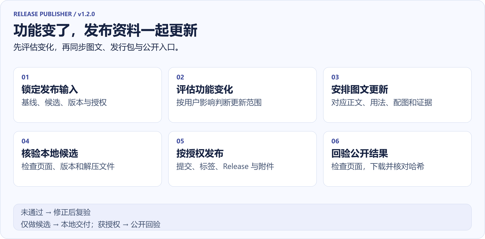
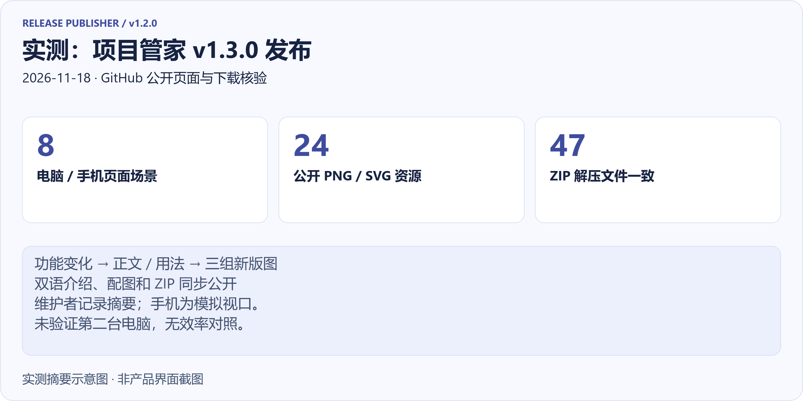
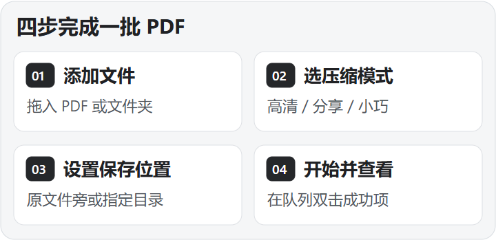

# 发布助手 · Release Publisher

[English](README.en.md) · [安装与调用](#安装与调用) · [新版工作方式](#新版工作方式) · [实际案例](#实际案例)

把已有的 **Agent Skill 或 Windows 桌面软件** 整理成可审阅、可发布、可核验的 GitHub 发行。功能变了，介绍、用法、配图和下载包也一起跟上。

<p align="center"><a href="assets/v1.2.0/release-flow-zh.svg"><picture><source media="(max-width: 600px)" srcset="assets/v1.2.0/release-flow-zh-mobile.png"></picture></a></p>

<a id="latest-release"></a>

> **最新版 · v1.2.0**
>
> 先比较功能变化，再决定哪些正文和图文要更新；准确旧图可以复用，核心流程变化则重构相应展示。中英文介绍、安装入口、ZIP 和 Release 同步核验。
>
> [下载新版](https://github.com/xmonk888-art/release-publisher/releases/download/v1.2.0/release-publisher-v1.2.0.zip) · [完整更新说明](https://github.com/xmonk888-art/release-publisher/releases/tag/v1.2.0)

<a id="安装与调用"></a>

## 安装与调用

**复制到 Codex 对话即可发起安装：**

```text
请使用 skill-installer，从 https://github.com/xmonk888-art/release-publisher/tree/v1.2.0 安装发布助手 release-publisher v1.2.0。技能位于仓库根目录，安装器参数为 --repo xmonk888-art/release-publisher --ref v1.2.0 --path . --name release-publisher。先检查并备份已有同名技能，保留自定义内容，核对 SKILL.md 版本为 1.2.0。若仓库下载失败，改用 https://github.com/xmonk888-art/release-publisher/releases/download/v1.2.0/release-publisher-v1.2.0.zip 解压安装。保留运行资源和准确的中文界面说明。安装后报告实际路径、版本、技能识别和刷新要求，只做只读调用检查，暂不发布任何项目。
```

也可[下载单技能 ZIP](https://github.com/xmonk888-art/release-publisher/releases/download/v1.2.0/release-publisher-v1.2.0.zip)，解压得到 `release-publisher/`。按当前客户端实际支持的技能目录安装，检查同名版本和自定义内容。Claude Code 使用其支持的技能导入方式；WorkBuddy 按“添加技能 → 上传技能”导入 ZIP 并确认启用。其他客户端与第二台电脑未实测，实际识别结果以目标机为准。

安装后，Codex 可用 `$release-publisher`，并确认当前会话已读取新版规则。新任务示例：

```text
使用 $release-publisher，为当前项目准备下一版 GitHub 发布资料。
先比较已发布版与本机更新，说明哪些功能正文、用法、截图或流程图需要调整。
同步中英文介绍、最新版摘要、下载入口和独立包，保留有效旧图与历史案例。
给我本地预览和检查结果，先不上传。
```

<a id="新版工作方式"></a>

## 新版工作方式

| 变化 | 默认处理 | 读者看到的结果 |
| --- | --- | --- |
| 修复问题，使用方式不变 | 更新版本说明，核对旧图是否仍准确 | 正确的更新记录，避免重复做图 |
| 新增独立功能 | 更新正文、使用示例；必要时增加图文 | 能找到新功能入口并理解结果 |
| 核心流程或交互变化 | 重写受影响用法，重构节点与分支 | 说明、流程图与新行为一致 |
| 定位或主要能力变化 | 重新评估首屏、核心能力和页面顺序 | 一眼理解新版是什么、适合谁 |

<p align="center"><a href="assets/v1.2.0/change-decisions-zh.svg"><picture><source media="(max-width: 600px)" srcset="assets/v1.2.0/change-decisions-zh-mobile.png"></picture></a></p>

先锁定基线、候选、版本和授权；再把重要变化对应到说明、用法、图文、证据和行动。小修不强制重画，核心功能也不能只藏在 Release 摘要中。软件功能优先使用目标版本的真实截图，Skill 用流程、分工与交接示意解释；没有实测的数据不写成实测。

### 从候选到公开发布

| 本轮范围 | 发布助手执行到哪里 |
| --- | --- |
| 先做候选 | 交付本地预览、发行包和检查记录，候选状态清楚可见 |
| 只更新详情页 | 更新指定文档与素材，检查实际页面和既有入口 |
| 正式发新版 | 同步提交、标签、Release 与附件；从公开地址重新下载回验 |

候选未通过先修正再检查；未获上传授权时保留在本地。已有版本、标签和历史证据保留原归属。Skill 是执行规范，依赖当前助手、软件、账号和工具环境。

## 功能与交付物

| 能力 | 交付物与检查 |
| --- | --- |
| 功能更新与图文策划 | 变化与展示映射、双语功能说明、使用示例、可编辑图稿 |
| Skill 独立 ZIP | 运行入口、引用资源与双语介绍；实际解压检查引用及版本 |
| Windows 软件发布 | 已构建程序、安装包、截图或 GIF；有目标环境才验证安装和运行 |
| GitHub 发行与核验 | 提交、标签、Release、附件；公开页面、下载哈希及恢复记录 |

<a id="实际案例"></a>

## 实际案例

### 项目管家 v1.3.0：新功能图文与发行同步

**2026-11-17 本地准备，2026-11-18 正式发布。**发布助手 v1.2.0 将“判断进度、确认最终目标、阶段衔接”映射到中英文正文、安装与使用入口，以及流程、目标关系和实测摘要三组图。旧 VI 案例保留原版本归属。

<p align="center"><a href="assets/v1.2.0/pm-release-case-zh.svg"><picture><source media="(max-width: 600px)" srcset="assets/v1.2.0/pm-release-case-zh-mobile.png"></picture></a></p>

- GitHub 四个中英文页面 × 1440/390 宽度，**8 个场景通过**。
- **24 个 PNG/SVG** 公开资源逐一与源文件比对。
- 公开 ZIP 重新下载并解压，**47 文件字节一致**，包内引用和版本检查通过。
- 固定版本 GitHub 地址经安装器隔离安装；这不代表第二台电脑的实际加载已经验证。

图为维护者根据实际发布记录整理的结果摘要，手机检查使用浏览器视口模拟；不是产品界面截图，也不量化效率提升。[案例与证据](cases/project-manager-1.3.0.md) · [公开 Release](https://github.com/xmonk888-art/project-manager/releases/tag/project-manager-v1.3.0)

### 历史软件图文案例

**PDF 高清压缩 v2.4.1** 的详情页更新只涉及图文资料。用公开页面验证了 320、390 和 1280 像素视口，手机选用纵向四步图，电脑选用原四宫格。两端均加载功能截图并播放 GIF，从 Release 重新下载的安装包通过 SHA-256 比对。

<picture>
  <source media="(max-width: 600px)" srcset="assets/case-pdf-zh-phone.png">
  
</picture>

截图来自公开 GitHub 页面中的流程图区域。手机显示使用浏览器模拟视口核验。[查看案例页面](https://github.com/xmonk888-art/pdf-compressor#一分钟上手) · [查看图文提交](https://github.com/xmonk888-art/pdf-compressor/commit/31555f8c6a201c2c9151b37f8c3b19bf92d3fac1)

以上为原有软件图文路线的历史案例，不作为 v1.2.0 新增变化判断规则的实测。

## 包内文件与验证边界

[技能入口](SKILL.md) · [功能变化规则](references/feature-update.md) · [软件图文规则](references/software-visual-guide.md) · [Skill 打包](references/skill-package.md) · [GitHub 发布与验收](references/github-release.md) · [附件核验脚本](scripts/check_release_artifact.py) · [版本记录](CHANGELOG.md)

实际公开验收按本轮产物记录；专业制作能力、GitHub 权限及软件环境需在目标机核对。未验证第二台电脑、其他客户端和桌面技能列表刷新/重启显示；软件历史案例不代表所有 Windows 安装包均已测试。
