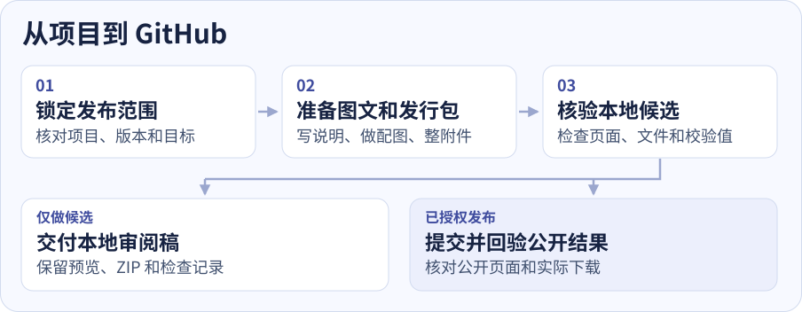
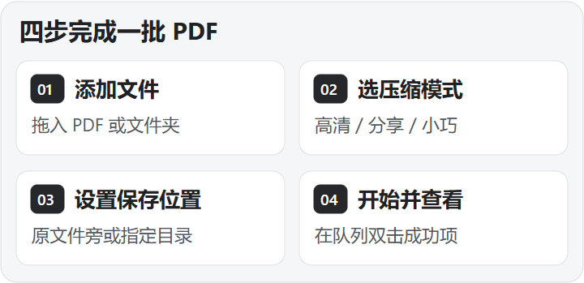

# 发布助手 · Release Publisher

[English](README.en.md) · [安装与调用](#安装与调用) · [工作流程](#工作流程) · [功能与交付物](#功能与交付物) · [实际案例](#实际案例)

把现有的 **Agent Skill 或 Windows 桌面软件** 整理成可审阅、可发布、可核验的 GitHub 发行。你给出项目和本轮范围，发布助手负责把介绍、配图、安装入口、发行包和版本记录对齐。

<a id="latest-release"></a>

> **最新版 · v1.1.0**
>
> Skill 和软件发布时，自动在中英文首页加入最新版摘要，并核对对应的下载和完整更新说明。
>
> [下载新版](https://github.com/xmonk888-art/release-publisher/releases/download/v1.1.0/release-publisher-v1.1.0.zip) · [完整更新说明](https://github.com/xmonk888-art/release-publisher/releases/tag/v1.1.0)

## 安装与调用

1. 取得 [release-publisher-v1.1.0.zip](https://github.com/xmonk888-art/release-publisher/releases/download/v1.1.0/release-publisher-v1.1.0.zip)，解压得到 `release-publisher` 文件夹。
2. 将整个文件夹放到项目的 `.agents/skills/` 下，使入口为 `.agents/skills/release-publisher/SKILL.md`。要跨项目使用，可放到用户的 `~/.agents/skills/` 下。若有同名技能，先核对现有版本和自定义内容。
3. 在 Codex 中打开项目，输入 `$release-publisher` 加上任务。如果列表尚未显示，重新打开 Codex 后再检查。[Codex 技能安装位置](https://learn.chatgpt.com/docs/build-skills#where-codex-loads-local-skills)

**复制到 Codex 对话**

```text
$release-publisher 用当前项目做一份 GitHub 图文发布候选。
保留现有版本，准备中英文 README、工作流程图和本地预览。
先核对页面和已有安装包，暂时不要上传。
```

## 工作流程

<picture>
  <source media="(max-width: 760px)" srcset="assets/workflow-zh-mobile.svg">
  
</picture>

| 你要做的事 | 发布助手怎么处理 |
| --- | --- |
| **先做候选** | 准备本地图文、发行包和检查记录，留出审阅入口。 |
| **只更新详情页** | 提交指定文档和公开素材，回验页面、图片及既有下载入口。 |
| **发布新版本** | 核对源码、版本、标签与附件，按授权发布，再从公开地址回验。 |

## 功能与交付物

| 功能 | 适用场景与交付物 |
| --- | --- |
| **图文详情页** | 整理中英文 README、操作流程图和下载入口。软件按功能配真实截图，适合演示顺序时加入短 GIF。 |
| **Skill 独立 ZIP** | 核对技能入口、相对引用与必要资源，打包并解压复验。 |
| **Windows 发行准备** | 对齐已构建程序、安装包、版本和兼容范围。有目标环境时核验安装、启动或升级。 |
| **GitHub 发布与回验** | 核对目标仓库和权限，处理提交、Release 和附件。记录公开页面、下载结果及 SHA-256。 |

本地准备可以先做。涉及 GitHub 写入时，需要账号具备相应权限和本轮操作授权。安装或运行结论以实际测试环境为准。

## 实际案例

**PDF 高清压缩 v2.4.1** 的详情页更新只涉及图文资料。用公开页面验证了 320、390 和 1280 像素视口，手机选用纵向四步图，电脑选用原四宫格。两端均加载功能截图并播放 GIF，从 Release 重新下载的安装包通过 SHA-256 比对。

<picture>
  <source media="(max-width: 600px)" srcset="assets/case-pdf-zh-phone.png">
  
</picture>

截图来自公开 GitHub 页面中的流程图区域。手机显示使用浏览器模拟视口核验。[查看案例页面](https://github.com/xmonk888-art/pdf-compressor#一分钟上手) · [查看图文提交](https://github.com/xmonk888-art/pdf-compressor/commit/31555f8c6a201c2c9151b37f8c3b19bf92d3fac1)

## 包内文件

- [技能入口](SKILL.md)包含适用范围、工作顺序和授权边界。
- [软件图文规则](references/software-visual-guide.md)和[独立打包规则](references/skill-package.md)覆盖两条制作路线。
- [GitHub 发布与验收](references/github-release.md)和[附件核验脚本](scripts/check_release_artifact.py)用于公开回验。
